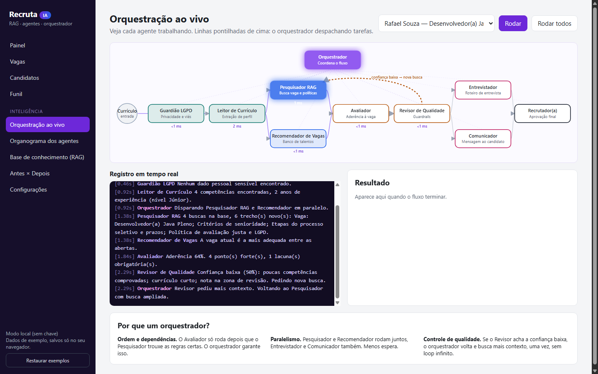
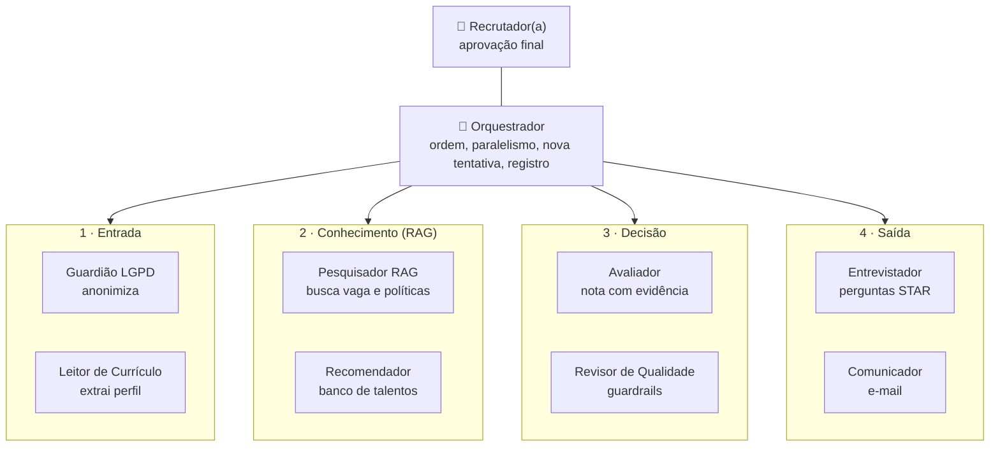
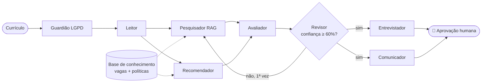
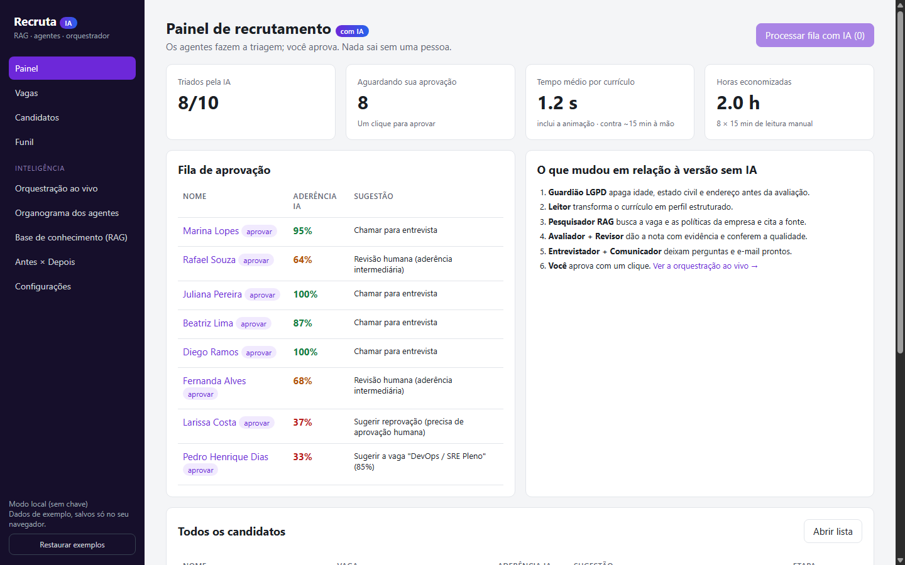
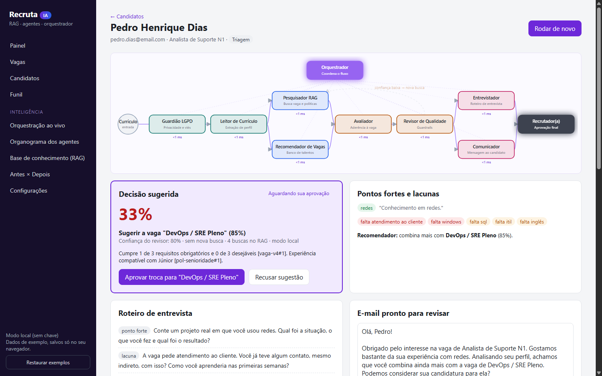
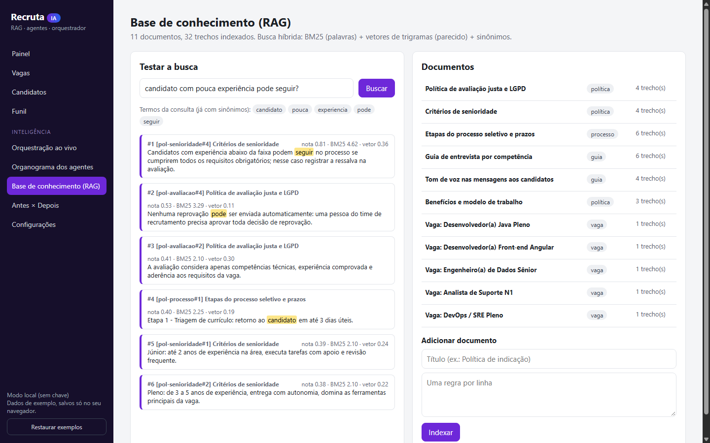
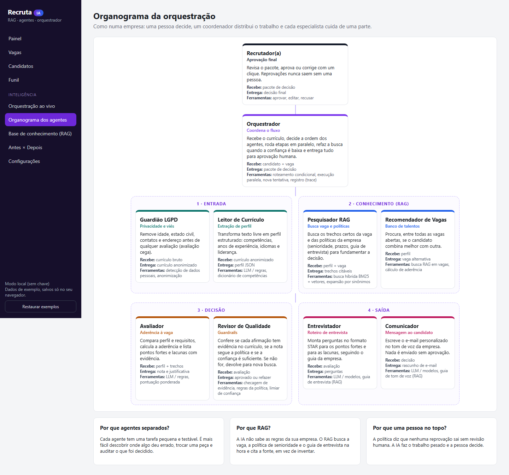
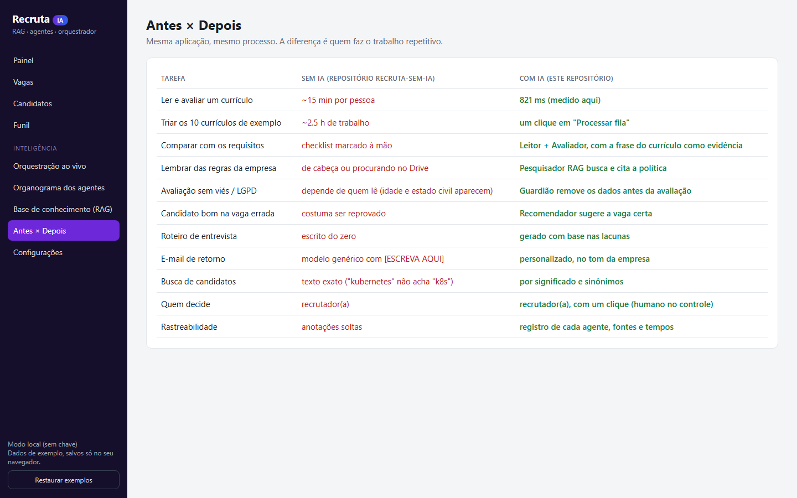

# Recruta IA: triagem de currículos com RAG, agentes de IA e orquestrador

**Demo ao vivo:** https://phb29.github.io/recruta-com-ia-rag-agentes/
**A mesma aplicação sem IA:** [recruta-sem-ia](https://github.com/Phb29/recruta-sem-ia) · [demo](https://phb29.github.io/recruta-sem-ia/)

Este repositório é a segunda metade de uma comparação. O primeiro, `recruta-sem-ia`, é um sistema de recrutamento comum: vagas, candidatos, funil e triagem feita à mão. Este aqui é **a mesma aplicação, com as mesmas telas e os mesmos dados**, mas com uma equipe de agentes de IA fazendo o trabalho repetitivo. Um orquestrador coordena essa equipe e uma base de conhecimento (RAG) dá a eles as regras da empresa.

A ideia é mostrar, lado a lado, **o que muda quando se coloca IA de verdade num processo**: não um chat jogado no canto da tela, mas agentes com papéis definidos, fontes citadas e uma pessoa aprovando no final.



---

## O que a IA faz aqui

| Tarefa | Sem IA | Com IA |
|---|---|---|
| Ler e avaliar um currículo | ~15 min por pessoa | segundos |
| Comparar com os requisitos | checklist marcado à mão | Leitor + Avaliador, com a frase do currículo como evidência |
| Lembrar das regras da empresa | de cabeça ou procurando no Drive | Pesquisador RAG busca a política e cita a fonte |
| Avaliação sem viés (LGPD) | idade e estado civil ficam na tela | Guardião apaga esses dados antes da avaliação |
| Candidato bom na vaga errada | costuma ser reprovado | Recomendador sugere a vaga certa |
| Roteiro de entrevista | escrito do zero | gerado a partir das lacunas |
| E-mail de retorno | modelo genérico com `[ESCREVA AQUI]` | personalizado, no tom da empresa |
| Busca de candidatos | texto exato ("kubernetes" não acha "k8s") | por significado e sinônimos |
| Quem decide | recrutador(a) | recrutador(a), com um clique |

Nos 10 currículos de exemplo, a fila inteira é triada com um clique. À mão seriam cerca de 2,5 horas.

---

## Por que RAG, agentes e orquestrador?

### Por que RAG (Retrieval-Augmented Generation)?
Um modelo de linguagem sabe muita coisa, mas **não sabe as regras da sua empresa**: qual a faixa de anos de um Pleno, o prazo de retorno, o que o guia de entrevista proíbe perguntar. Se você não der essas regras, ele inventa.

O RAG resolve isso: antes de avaliar, o agente **busca os trechos certos** na base de conhecimento (vaga, política de senioridade, política de LGPD, guia de entrevista) e usa só isso como contexto. Cada afirmação sai com a fonte entre colchetes, por exemplo `[pol-senioridade#4]`, e pode ser conferida na tela.

### Por que vários agentes em vez de um prompt gigante?
Um prompt único que "lê, avalia, decide, escreve e-mail" é difícil de testar e de corrigir. Aqui cada agente tem **uma tarefa pequena, com entrada e saída definidas**, como numa equipe:

- se a nota está estranha, você olha o Avaliador;
- se apareceu dado pessoal, você olha o Guardião;
- se quiser trocar o modelo de um agente só, você troca só ele.

### Por que um orquestrador?
Alguém precisa coordenar a equipe:

- **Ordem e dependências:** o Avaliador só roda depois que o Pesquisador trouxe as regras.
- **Paralelismo:** Pesquisador e Recomendador rodam juntos; Entrevistador e Comunicador também.
- **Controle de qualidade:** se o Revisor acha a confiança baixa (currículo curto, nota na zona cinzenta), o orquestrador **volta e faz uma busca ampliada**, uma vez só, sem laço infinito.
- **Pessoa no controle:** o fluxo termina numa aprovação humana. Reprovação nunca sai sozinha.

---

## Organograma da orquestração



## Fluxo de execução



Os quatro caminhos aparecem nos dados de exemplo:

| Candidato | Resultado | O que mostra |
|---|---|---|
| Marina Lopes | 95%, chamar para entrevista | Guardião remove idade, cidade e estado civil |
| Rafael Souza | 64%, revisão humana | Revisor pede **nova busca** (currículo curto) |
| Fernanda Alves | 68%, revisão humana | "Nunca trabalhei com Angular" **não** conta como Angular |
| Larissa Costa | 37%, sugerir reprovação | Fica pendente até uma pessoa aprovar |
| Pedro Henrique Dias | 33% na vaga dele | Recomendador sugere **DevOps/SRE (85%)** |

---

## Telas

| | |
|---|---|
|  |  |
| Painel com fila de aprovação e horas economizadas | Decisão sugerida, evidências, roteiro e e-mail |
|  |  |
| Fontes do RAG, dados removidos e registro de execução | Base de conhecimento: teste a busca híbrida |
|  |  |
| Organograma dos agentes | Comparação com a versão sem IA |

---

## Como funciona por dentro

```
js/
├── app.js               telas (mesmas da versão sem IA + telas de IA)
├── store.js, data.js    dados e persistência (iguais à versão sem IA)
└── ia/
    ├── conhecimento.js  documentos da empresa e sinônimos (a base do RAG)
    ├── rag.js           chunking, BM25, vetores de trigramas, busca híbrida
    ├── agentes.js       os 8 agentes especialistas
    ├── orquestrador.js  fluxo, paralelismo, nova tentativa, eventos
    ├── grafo.js         desenho do fluxo ao vivo (SVG)
    └── llm.js           modo local ou Claude API
```

**RAG:** cada documento é quebrado em trechos. A busca junta duas notas: BM25 (palavras em comum, 70%) e similaridade de vetores de trigramas (parecido, 30%), com expansão de sinônimos (`k8s → kubernetes`, `pyspark → spark`). Tudo roda no navegador, sem servidor. Em produção, troque os trigramas por embeddings reais (pgvector, Qdrant etc.).

**Dois modos:**
- **Local (padrão):** os agentes de linguagem usam regras determinísticas. Roda sem chave, sem custo e sem backend, por isso a demo funciona no GitHub Pages.
- **Claude API:** em *Configurações*, cole uma chave da Anthropic. Leitor, Avaliador e Comunicador passam a usar o Claude (`claude-opus-5-5`) pelo SDK oficial. Se a chamada falhar, o agente volta sozinho para o modo local e avisa. Mesmo no modo Claude, o Revisor compara a nota do modelo com a nota por regra e corrige desvios grandes.

> A chave fica no `localStorage` do seu navegador e a chamada sai direto dele. Isso serve para demonstração. Em produção, faça a chamada a partir de um backend.

---

## Rodar localmente

Não precisa instalar nada além do Node (ou de qualquer servidor estático):

```bash
git clone https://github.com/Phb29/recruta-com-ia-rag-agentes.git
cd recruta-com-ia-rag-agentes
npx serve .          # ou: python -m http.server 8000
```

Testes (rodam a orquestração nos 10 currículos, sem navegador):

```bash
node tests/orquestracao.test.mjs
```

O teste confere que: nenhum dado pessoal chega aos agentes, todo ponto forte tem evidência no currículo, negação ("nunca trabalhei com") é respeitada, o Revisor pede nova busca quando deve, reprovação fica pendente de aprovação humana e a busca por `k8s` acha a vaga de DevOps.

---

## Limites (para ser honesto)

- No modo local, "LLM" são regras. É de propósito, para a demo rodar de graça. O ganho de tempo e a estrutura (RAG, agentes, orquestrador, aprovação humana) são os mesmos com um modelo real.
- O tempo de "15 min por currículo" é uma referência comum de mercado. A versão sem IA mede o seu tempo real com um cronômetro na tela de triagem.
- Os dados são fictícios e ficam só no seu navegador.

## Tecnologias

HTML, CSS e JavaScript puro (ES Modules), sem build. SVG para o grafo. SDK oficial da Anthropic (opcional). GitHub Pages para a demo.
